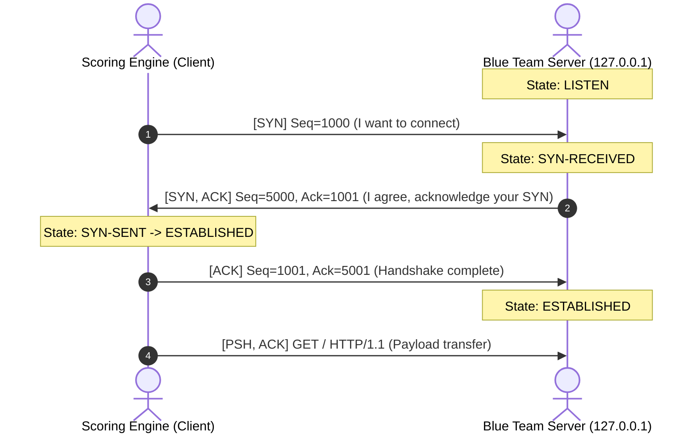
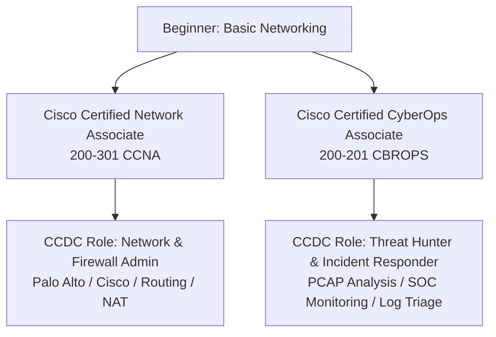

# The Scored Wire: Network Fundamentals and Socket Triage for CCDC

At 09:04 on competition morning, the CCDC scoring engine attempts a TCP connection to your team's web server on port 80. Three thousand milliseconds later, the poll times out. On the central scoreboard, the green badge next to your team's web node flips to red, deducting 15 points per polling cycle. The Linux admin insists Apache is running. The firewall admin insists the interface link is up. Nobody has inspected the socket table.

In a Collegiate Cyber Defense Competition, uptime SLA is the currency. You do not win by hardening an operating system into an unreachable stone; you win by keeping scored services continuously accessible to the automated scoring bot while denying unauthorized pivot paths to the Red Team. When a service availability check fails, you have roughly two minutes to determine whether the breakdown lives at Layer 2 (ARP table poisoning or missing MAC resolution), Layer 3 (a misconfigured default gateway), Layer 4 (a silent firewall drop or exhausted SYN backlog), or Layer 7 (an application crash).

To diagnose that pipeline under active attack, you must understand packet mechanics at the wire level. By the end of this part, you will understand how IPv4 subnets route across competition interfaces, how [RFC 9293](https://www.rfc-editor.org/rfc/rfc9293.html) establishes TCP socket states, and how to operate a local triage harness on your own workstation to verify scored connections in seconds.

## What you'll build

You will deploy a local CCDC mock service harness on your workstation using Python and PowerShell. You will dissect the exact byte-level mechanics of the TCP three-way handshake, trigger and diagnose the three classic competition failure modes (the silent drop, the immediate reset, and the SYN timeout), and inspect live socket state tables (`LISTEN`, `ESTABLISHED`, `SYN_SENT`) to isolate network failures without external virtual machines.

## Prerequisites

- **PowerShell 5.1+** (installed by default on Windows 10/11) or **PowerShell 7+** (cross-platform).
- **Python 3.8+** accessible from your terminal (`python --version`).
- **`curl.exe`** (pre-installed on modern Windows builds).
- Baseline familiarity with typing commands in a terminal. No administrative privileges or external VMs are required; all exercises run on loopback sockets above port 1024.

---

## Mapping the wire: IPv4 subnets, RFC 1918, and default gateways

Every CCDC competition environment is partitioned into distinct network segments. The scoring engine resides on an external scoring subnet, the White Team judges reside on an administrative subnet, and your Blue Team inherits an enterprise enclave composed of public-facing web servers, internal database servers, and Active Directory Domain Controllers.

Under [RFC 791](https://www.rfc-editor.org/rfc/rfc791.html), an IPv4 address is a 32-bit integer formatted as four 8-bit octets. A subnet mask divides those 32 bits into two segments: the **Network ID** (identifying the wire) and the **Host ID** (identifying the specific interface on that wire).

In CCDC topologies, two subnet sizes appear constantly:

| CIDR Prefix | Subnet Mask | Total Addresses | Usable Hosts | Typical CCDC Role |
| :--- | :--- | :--- | :--- | :--- |
| `/24` | `255.255.255.0` | 256 | 254 | Internal server LAN / Workstations |
| `/28` | `255.255.255.240` | 16 | 14 | DMZ (Public Web, Mail, DNS) |

The first address in any subnet is reserved as the **Network Identifier** (Host bits all zero), and the final address is reserved as the **Broadcast Identifier** (Host bits all one). A `/28` subnet configured at `192.168.1.16/28` provides:
- Network ID: `192.168.1.16`
- Usable Host Range: `192.168.1.17` through `192.168.1.30` (14 hosts)
- Broadcast ID: `192.168.1.31`

> [!HEADS-UP]
> Assigning a network ID (`.16`) or broadcast ID (`.31`) to a server's network adapter will fail silently or break routing across the entire segment. Always verify usable ranges before editing static IP configuration files.

Every host on a subnet communicates directly with neighbors on the same wire using Layer 2 ARP. To reach any address outside that local mask—such as the scoring engine or an inject server—the operating system forwards the packet to its **Default Gateway**.

To view the active IPv4 routing table on your Windows machine, open PowerShell and run:

```powershell
Get-NetRoute -AddressFamily IPv4 | Where-Object DestinationPrefix -eq '0.0.0.0/0'
```

Notice the `DestinationPrefix` of `0.0.0.0/0`. This is the "route of last resort." If a destination IP does not match any local subnet route, the kernel pushes the frame to the `NextHop` IP listed in that row.

> [!DESIGN-NOTE]
> **Why CCDC uses RFC 1918 with 1:1 NAT instead of public IPs**
>
> Commercial networks use private IP spaces standardized in [RFC 1918](https://www.rfc-editor.org/rfc/rfc1918.html): `10.0.0.0/8`, `172.16.0.0/12`, and `192.168.0.0/16`. CCDC organizers assign your internal servers private RFC 1918 addresses behind an edge firewall (such as a Palo Alto or pfSense appliance).
> 
> The edge firewall performs **Destination Network Address Translation (DNAT)** or **1:1 NAT**, mapping an external IP polled by the scoring engine (e.g., `10.0.100.25`) to your actual server's internal address (`192.168.1.10`). If a service is running locally on the server but scoring fails from the outside, the breakdown is almost always a misconfigured NAT rule or an edge firewall access control list (ACL), not the host service itself.

Now that we know how packets navigate the wire, we can examine how TCP establishes an active conversation.

---

## The scored heartbeat: dissecting the TCP 3-way handshake under RFC 9293

Every scored network service in CCDC—HTTP (80), HTTPS (443), SSH (22), DNS zone transfers (53/tcp), and Active Directory LDAP (389)—relies on the Transmission Control Protocol to guarantee delivery.

Under [RFC 9293](https://www.rfc-editor.org/rfc/rfc9293.html) (which unifies and obsoletes RFC 793), a TCP connection requires a mutual synchronization exchange known as the **three-way handshake**:



Here is the exact progression:
1. **SYN (Synchronize):** The client sends a TCP segment with the `SYN` control flag enabled and an Initial Sequence Number (`ISN = X`). The client transitions from `CLOSED` to `SYN-SENT`.
2. **SYN-ACK (Synchronize-Acknowledgment):** The server receives the SYN on a socket in the `LISTEN` state. It allocates a transmission control block (TCB), increments the client's sequence number by 1 (`Ack = X + 1`), selects its own sequence number (`Seq = Y`), sets both `SYN` and `ACK` flags, and transitions to `SYN-RECEIVED`.
3. **ACK (Acknowledgment):** The client acknowledges the server's sequence number (`Ack = Y + 1`). Both sockets enter `ESTABLISHED`. Only now can application-layer data flow.

A TCP segment carries a fixed 20-byte base header (or up to 60 bytes with options), preceded by a 20-byte IPv4 base header. That means **40 bytes of network overhead** traverse the wire before a single byte of HTTP data is transmitted.

> [!ASIDE]
> An Initial Sequence Number (ISN) is not zero. Modern operating systems randomize the 32-bit ISN using cryptographic clock algorithms to prevent blind TCP connection hijacking and sequence number prediction attacks.

Next, we will launch a local mock harness so you can watch these state transitions happen on your own computer.

---

## Building the local CCDC mock service harness

To practice network socket triage without needing a multi-machine lab, we will use a Python service harness located in your repository at [`mock_ccdc_services.py`](file:///C:/Users/mobil/alan-code/Learn%20Cyber%20Repo/Cybersec-Learning/module-01-networking/mock_ccdc_services.py).

The script binds two distinct sockets on `127.0.0.1`:
1. **Port 8080 (HTTP Server):** Simulates a scored web application returning `200 OK` with an uptime SLA verification string.
2. **Port 9000 (Echo Server):** Simulates a raw TCP daemon that accepts connections and echoes back payloads.

Review the core socket binding block from [`mock_ccdc_services.py`](file:///C:/Users/mobil/alan-code/Learn%20Cyber%20Repo/Cybersec-Learning/module-01-networking/mock_ccdc_services.py#L43-L52):

```python
sock = socket.socket(socket.AF_INET, socket.SOCK_STREAM)
sock.setsockopt(socket.SOL_SOCKET, socket.SO_REUSEADDR, 1)
sock.bind((HOST, ECHO_PORT))
sock.listen(5)
```

Notice `sock.listen(5)`. The argument `5` defines the **backlog queue**: the maximum number of pending unaccepted connections the operating system kernel will hold in the `SYN-RECEIVED` state before dropping new incoming `SYN` packets.

Start the mock harness in your terminal:

```powershell
python ".\Cybersec-Learning\module-01-networking\mock_ccdc_services.py"
```

Leave that terminal running. It will output confirmation that both services are actively listening on `127.0.0.1:8080` and `127.0.0.1:9000`.

---

## Socket states under fire: diagnosing LISTEN, ESTABLISHED, and SYN_SENT

With the harness running, open a second terminal. We will use PowerShell's [`Get-NetTCPConnection`](https://learn.microsoft.com/en-us/powershell/module/nettcpip/get-nettcpconnection) cmdlet to inspect the local TCP state table.

To see all sockets currently listening on your machine, run:

```powershell
Get-NetTCPConnection -State Listen | Where-Object LocalPort -in 8080, 9000
```

You will see output structured like this:

```
LocalAddress  LocalPort RemoteAddress RemotePort State  AppliedSetting OwningProcess
------------  --------- ------------- ---------- -----  -------------- -------------
127.0.0.1     8080      0.0.0.0       0          Listen Internet       14820
127.0.0.1     9000      0.0.0.0       0          Listen Internet       14820
```

Notice `RemoteAddress` is `0.0.0.0` and `RemotePort` is `0`. A socket in the `Listen` state does not have a remote partner yet; it is passively waiting for an inbound `SYN`.

Now, simulate a CCDC scoring poll against the mock web server using `curl.exe`:

```powershell
curl.exe -i http://127.0.0.1:8080
```

The output confirms the connection:

```http
HTTP/1.0 200 OK
Server: BaseHTTP/0.6 Python/3.11.9
Content-Type: text/plain
Content-Length: 43

CCDC_SERVICE_STATUS: OK - UPTIME_SLA_PASSED
```

Now let's examine what happens when an endpoint fails. In CCDC, connectivity failures exhibit two distinct behaviors depending on how the firewall or server drops the packet:

### 1. The Immediate Reset (Port Closed / REJECT)
When a client sends a `SYN` to a port where no process is listening (or where a firewall rule specifies `REJECT`), the host kernel immediately replies with a `RST` (Reset) packet.

Test this against unused port `8081` using [`Test-NetConnection`](https://learn.microsoft.com/en-us/powershell/module/nettcpip/test-netconnection):

```powershell
Test-NetConnection -ComputerName 127.0.0.1 -Port 8081 -InformationLevel Detailed
```

The check returns in milliseconds with `TcpTestSucceeded : False`. The operating system received a `RST` segment immediately, terminating the attempt.

### 2. The Silent Drop (Blackhole / DROP)
When an intermediate firewall or host filter silently drops packets with a `DROP` target instead of `REJECT`, no `RST` packet is sent back. 

The client's socket remains stuck in `SYN_SENT`. It retransmits the `SYN` at exponential backoff intervals (typically 1 second, 3 seconds, 6 seconds) until the operating system's connection timeout budget expires (often 20 to 30 seconds).

> [!HEADS-UP]
> **Why DROP rules can destroy CCDC scoring:**
> Scoring bots operate with tight timeouts (often 3,000 to 5,000 ms). If a teammate misconfigures an `iptables` or Windows Defender rule with a silent `DROP`, the scoring thread hangs until its timeout expires, recording a hard SLA failure. When diagnosing a red score, always check if your socket is hanging in `SYN_SENT`—that is the signature of a packet being dropped in transit.

To view your custom socket inspector script, inspect [`inspect_sockets.ps1`](file:///C:/Users/mobil/alan-code/Learn%20Cyber%20Repo/Cybersec-Learning/module-01-networking/inspect_sockets.ps1):

```powershell
.\Cybersec-Learning\module-01-networking\inspect_sockets.ps1 -Port 8080
```

This helper maps the listening port directly to its `PID` and `ProcessName` (`python`), answering the critical competition question: *is our service actually bound to this port, or did an attacker's backdoor replace it?*

---

## The triage matrix: distinguishing Layer 2 to Layer 7 failures

When the scoring board turns red, use this four-layer triage checklist to find the root cause in under 90 seconds:

```
[Layer 7: App]    Does 'curl http://localhost:<port>' return expected payload?
        | (No: restart service, check app logs, fix bad config)
[Layer 4: Socket] Does 'Get-NetTCPConnection -LocalPort <port>' show 'Listen'?
        | (No: port closed or hijacked; Yes: host is listening)
[Layer 3: Route]  Can the host ping its Default Gateway? ('Test-NetConnection -CommonTCPPort')
        | (No: interface down, IP clash, or route missing)
[Layer 2: Link]   Does 'arp -a' show a valid physical MAC address for the gateway?
```

| Layer | Failure Symptom | Immediate Diagnostic Command | Typical Root Cause |
| :--- | :--- | :--- | :--- |
| **Layer 2 (Data Link)** | Gateway unreachable; "Destination host unreachable" | `arp -a` | ARP poisoning by Red Team; duplicate IP address assigned on LAN. |
| **Layer 3 (Network)** | Can ping local subnet, cannot ping external scoring IP | `Get-NetRoute -AddressFamily IPv4` | Missing default gateway (`0.0.0.0/0`) or wrong subnet mask. |
| **Layer 4 (Transport)** | Connection times out; client socket stuck in `SYN_SENT` | `Get-NetTCPConnection -State SynSent` | Host firewall dropping packets; edge firewall NAT misconfigured. |
| **Layer 7 (Application)**| Handshake succeeds (`200 OK`), but score is 0 | `curl.exe -Iv http://127.0.0.1:<port>` | Web app returns `500 Internal Server Error` or modified verification text. |

---

## Checkpoint

> [!PREDICT]
> Before you run this: what will `Test-NetConnection -ComputerName 127.0.0.1 -Port 9000` report for `TcpTestSucceeded` while the mock harness is active?

**Run this to verify your work so far:**
```powershell
Test-NetConnection -ComputerName 127.0.0.1 -Port 9000
```

Expected output:
```text
ComputerName           : 127.0.0.1
RemoteAddress          : 127.0.0.1
RemotePort             : 9000
InterfaceAlias         : Loopback Pseudo-Interface 1
SourceAddress          : 127.0.0.1
TcpTestSucceeded       : True
```

**Likely errors:**
- If you see `TcpTestSucceeded : False`, the Python mock harness is not running. Switch to your first terminal window and ensure `mock_ccdc_services.py` is active.
- If you see `Permission denied` or `Address already in use`, another process is already occupying port 8080 or 9000. Run `Get-NetTCPConnection -LocalPort 9000` to identify and terminate the conflicting process ID.

---

## Practice labs & Cisco certification pathways

Mastering networking at the wire level is the single highest-leverage investment for competitive cyber defense. Here are direct practice resources and certification roadmaps:

### 1. Hands-on Practice Environments
- **[Cisco Packet Tracer](https://www.netacad.com/courses/packet-tracer)** (Free): The premier simulation tool for building virtual subnets, configuring Cisco routers/switches, and visually stepping through the packet flow of ARP requests and TCP handshakes frame-by-frame.
- **[TryHackMe: Network Fundamentals Path](https://tryhackme.com/module/network-fundamentals)**: Interactive browser-based labs covering OSI layers, IP addressing, subnetting calculations, and packet inspection with `tcpdump` and Wireshark.
- **[Wireshark Sample Captures](https://wiki.wireshark.org/SampleCaptures)**: Download real `.pcap` files of TCP SYN floods, port scans, and HTTP transactions to practice filtering by `tcp.flags.syn == 1 && tcp.flags.ack == 0`.

### 2. Cisco Certification Pathways for CCDC Blue Teamers



#### Pathway A: [Cisco CCNA (200-301)](https://www.cisco.com/c/en/us/training-events/training-certifications/exams/current-list/ccna-200-301.html)
- **Focus:** Network infrastructure, routing protocols, subnetting mastery, switching, and access control lists (ACLs).
- **Direct CCDC Value:** If you want to own the team's firewall appliance, manage the default gateway, configure NAT rules, and ensure segmentation between the scoring engine and your internal hosts, CCNA is the gold standard.

#### Pathway B: [Cisco CyberOps Associate (200-201 CBROPS)](https://www.cisco.com/c/en/us/training-events/training-certifications/exams/current-list/cbrops-200-201.html)
- **Focus:** Security Operations Center (SOC) operations, network intrusion analysis, interpreting PCAPs and NetFlow telemetry, host-based analysis, and incident response procedures.
- **Direct CCDC Value:** Matches the CCDC Incident Responder role. Teaches you how to distinguish normal application traffic from attacker beacons, reverse shells, and unauthorized data exfiltration.

---

## What's next

Before you move on: in two sentences, why does an accidental firewall `DROP` rule pose a far greater risk to CCDC scoring uptime than an accidental `REJECT` rule? Formulate the answer in your own words based on socket timeout behavior.

In **Module 2**, we move from the wire to the operating system internals: dissecting how Linux POSIX permissions and Windows NTFS inheritance protect critical configuration files, and how to identify malicious processes masquerading as legitimate system services.

---

## Exercises

- [ ] Run `Get-NetTCPConnection -State Established` while loading a website in your browser, and identify the remote IP and ephemeral local port assigned to your browser session.
- [ ] In [`mock_ccdc_services.py`](file:///C:/Users/mobil/alan-code/Learn%20Cyber%20Repo/Cybersec-Learning/module-01-networking/mock_ccdc_services.py), change the `HTTP_PORT` to `8888`, restart the script, and verify using `curl.exe` and `inspect_sockets.ps1`.
- [ ] Calculate the Network ID, Broadcast ID, and usable host IP range for the subnet `10.10.20.64/26`.
- [ ] Use `Test-NetConnection -ComputerName 1.1.1.1 -Port 53` to verify outbound DNS connectivity and observe the round-trip latency.

---

## Sources

1. [RFC 9293: Transmission Control Protocol (TCP)](https://www.rfc-editor.org/rfc/rfc9293.html) — Current IETF standard defining the TCP specification, sequence numbers, and connection state transitions.
2. [RFC 791: Internet Protocol](https://www.rfc-editor.org/rfc/rfc791.html) — Foundational specification of IPv4 packet headers, addressing, and fragmentation.
3. [RFC 1918: Address Allocation for Private Internets](https://www.rfc-editor.org/rfc/rfc1918.html) — Definition of reserved private IPv4 address spaces (`10.0.0.0/8`, `172.16.0.0/12`, `192.168.0.0/16`).
4. [Microsoft Learn: Get-NetTCPConnection](https://learn.microsoft.com/en-us/powershell/module/nettcpip/get-nettcpconnection) — Official reference for querying active TCP connections and listening sockets in PowerShell.
5. [Microsoft Learn: Test-NetConnection](https://learn.microsoft.com/en-us/powershell/module/nettcpip/test-netconnection) — Diagnostic command reference for testing port reachability, ICMP routing, and network latency.
6. [Cisco CCNA 200-301 Exam Topics](https://www.cisco.com/c/en/us/training-events/training-certifications/exams/current-list/ccna-200-301.html) — Official blueprint for foundational enterprise networking, routing, and access control.
7. [Cisco CyberOps Associate 200-201 CBROPS Exam Topics](https://www.cisco.com/c/en/us/training-events/training-certifications/exams/current-list/cbrops-200-201.html) — Official blueprint for Security Operations Center analysis, packet investigation, and incident response.
